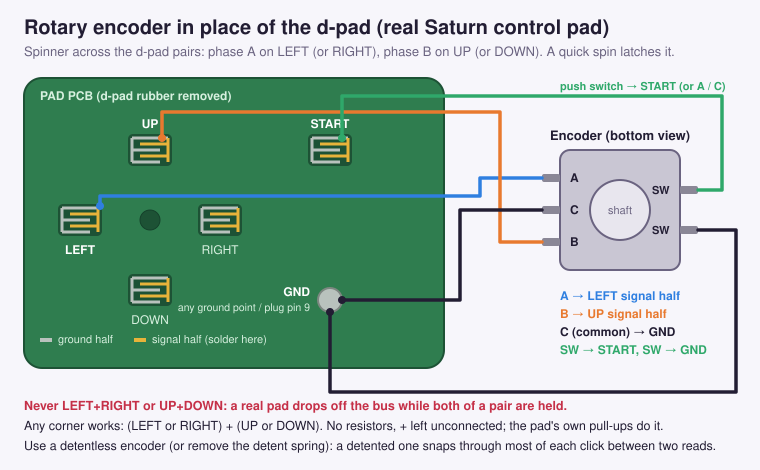

# Magical Drop III Saturn Paddle Edition: Technical Breakdown

Oct 21, 2026 · @Pete

The Saturn Paddle Edition patches `0.BIN` of Magical Drop III Toretate Zoukangou! (Japan, T-1313G) so the clown is driven by a virtual paddle from a Shuttle Mouse, an Arcade Racer wheel, a 3D Control Pad or Mission Stick in analog mode, or a JP3-style spinner on the d-pad or on Y/Z. It is the same design as the PS1 Paddle Edition, adapted to SGL and the SH-2.

## At a glance

All devices go through one replacement PadRead. The game still only sees its normal held/pressed/released words. The patch's own per-player tick turns motion into one column step per tick in play, and into single d-pad taps everywhere else.

| | PS1 (SLES-02964) | Saturn (T-1313G) |
| --- | --- | --- |
| Executables | 6 language EXEs + selector | one `0.BIN`, loaded at 0x06004000 |
| Pad library | BIOS B(15h), replaced by InitPAD/StartPAD | SGL `Smpc_Peripheral[]`, already parsed every VBlank |
| Hook style | jal/j patches at signature-found sites | 3 retargeted function-pointer literals + 4 inline draw-site patches |
| Patch code | ~6 KB in 20 chunks | 2.9 KB in 16 chunks |
| Free space | 8.5 to 9.8 KB per language | 6.9 KB in 44 holes, largest 456 bytes |

## Disc and executable

The Saturn data track is one MODE1/2352 track. The patch rewrites `0.BIN` in place; only the 16 sectors that changed get new EDC/ECC.

| Item | Value |
| --- | --- |
| Source image | Track 01, 5,116 sectors, 12,032,832 bytes, CRC32 97D3B2B2 |
| Patched Track 01 | CRC32 E29E1022 (default options) |
| Boot | IP.BIN first read address 0x06004000, `0.BIN` at LBA 29, 564,848 bytes |
| Library | SGL 2.11 (`GFS_SGL Version 2.11 1996-03-21`), GBR = 0x060FFC00 |
| Other tracks | CD-DA, untouched; a BIN/CUE set only needs Track 01 replaced |

## The input path

SGL already does the hard part the PS1 needed a new driver for: its INTBACK handler parses every peripheral type into 24-byte `Smpc_Peripheral` entries each VBlank.

- **SGL buffer**: pointer at 0x06050B48 (0x06050D84 at run time). Entry: +0 ID, +2 data, +4 push, +6 pull (all active low), +8 analog X or mouse X, +10 mouse Y.
- **Slots**: the game maps players to entries through 0x0607B868 (P1 = slot 0, P2 = slot 15, SGL's port 2 position).
- **Game PadRead** at 0x06020998 inverts data/push/pull into held 0x060B3D6C, pressed 0x060B3D64 and released 0x060B3D68 (`p1, p2` words, active high, SGL bit layout: RIGHT 0x8000 … START 0x0800, A 0x0400, C 0x0200, B 0x0100).
- **Hook**: the only call loads 0x06020998 from the literal at 0x06020468; that literal now points at `pad_read`. The build checks that exactly one `mov.l @(disp,PC)` uses each retargeted literal.

What SGL does to each device, measured in the emulator and checked against the SGL handler code:

| Device | ID | What arrives | What SGL adds |
| --- | --- | --- | --- |
| Shuttle Mouse | 0xE3 | +8/+10 x/y | x/y are **accumulated positions** (`x += dx`, `y -= dy`, 16-bit wrap, no clamp); buttons on A/C/B/START bits; it also sets d-pad bits when \|d\| ≥ 2 |
| Arcade Racer | 0x13 | +8 wheel 0x00..0xFF | the wheel itself reports LEFT/RIGHT past 0x67/0x97; shift paddles are UP/DOWN |
| 3D Control Pad | 0x16 | +8 X, +9 Y, triggers | nothing (digital mode is plain ID 0x02) |
| Mission Stick | 0x15 | +8 X, +9 Y, throttle | nothing |
| Control Pad | 0x02 | buttons | nothing |

## Replacement PadRead

`pad_read` fills the same three words for both players, then dispatches on the entry's ID.

- **Mouse**: delta = position − last position (s16). The synthesized d-pad bits are dropped. Left → A, right → B, middle → R trigger, START kept; left+right held is START, pressed when either button goes down.
- **Wheel**: X is kept for the tick; LEFT/RIGHT from the wheel never reach the game. Paddles stay UP/DOWN.
- **Analog stick**: the stick engages once it leaves ±0x28 of centre; d-pad left/right hands control back to the d-pad until the stick moves again.
- **Digital**: JP3 detection on d-pad left/right or on Y/Z (below); otherwise untouched. A 3D pad in analog mode also gets the Y/Z check.
- **Device change**: a new ID resets the port's state (JP3 latch, accumulators, engaged flag; paddle position marked unsynced). SGL reports 0xFF for an empty port, so unplugging is just another ID change.

## Controllers in play

| Controller | Paddle | Buttons |
| --- | --- | --- |
| Shuttle Mouse | relative, units per count from the speed setting (1, 2, 4, 8 = ×¼ … ×2) | left = catch, right = throw, middle = pull-down, through the player's own masks |
| Arcade Racer | absolute, 0x10..0xF0 across the field | the wheel's own buttons |
| 3D pad / Mission Stick | absolute, centre ±0x60 across the field | as wired |
| JP3 spinner, d-pad wiring | relative, 32 units per edge (4 edges per column) | other buttons unchanged; LEFT/RIGHT never reach the game |
| JP3 spinner, Y/Z wiring | same, phase A on Y, phase B on Z | Y/Z never reach the game; the d-pad stays live |
| JP3 spinner across the d-pad pairs | same, phase A on LEFT or RIGHT, phase B on UP or DOWN; latches after two frame-perfect A↔B flips within a second | the whole d-pad is the spinner |

- **Why Y/Z**: USB-to-Saturn adapters such as the Brook Wingman SD present the source pad's d-pad, which is often an 8-way hat or SOCD-cleaned, so left+right never arrives. Y and Z are spare with the default controls (catch = A/C/X/Z, throw = B/Y) and pass through as plain buttons. The pair that first reads both pressed is the one that latches.
- **Real pads: wire across the d-pad pairs**: a Saturn control pad drops off the bus while LEFT+RIGHT or UP+DOWN are held together (found on hardware with an encoder wired to LEFT/RIGHT: the pad disconnected on every other click, where the encoder rests with both contacts closed). The console identifies the pad from those lines OR'd in pairs, so holding both lines of a pair changes the ID. The LEFT/RIGHT wiring therefore only works through adapters that build their own report. For an encoder in a real pad, phase A goes on LEFT or RIGHT and phase B on UP or DOWN. Before any latch, `jp3_cross` watches those two signals: a frame-perfect flip from A-only to B-only (or back) is two edges in one read, which a spun encoder produces all the time and a thumb on the rocker almost never does (a diagonal or neutral frame shows in between). Two such flips within 60 reads latch it; after that the whole d-pad belongs to the spinner. The patcher's **latch on first diagonal** option (flag bit 5, off by default) latches on the first diagonal instead, for encoders turned too slowly to flip. Whether Y+Z is safe on a real pad has not been checked.

- **D-pad with a Y/Z spinner**: a real left/right press goes through to the game and marks the paddle unsynced, so it re-centres on the column the clown moved to.
- **JP3 decode**: same as PS1. Position = A xor 3B (A = LEFT, B = RIGHT) maps 00/10/11/01 to 0/1/2/3; delta mod 4 gives +1, −1, or 2 counted as two edges in the last direction, since SGL also reads once per frame.
- **Mouse buttons in play** go through the player struct's masks (+0x358 catch, +0x35A throw, +0x35C pull-down), so a remapped control setup keeps working.

## In-game paddle model

The player struct is the PS1 one, field for field (+0x18 column, +0x1C colour held, +0x20 balloons held, +0x358/35A/35C masks, +0x362/+0x364 left/right masks), which says a lot about how the two ports were made.

- **Hook**: the clown movement routine 0x06010E68 gets its tick buttons from 0x0600E208, loaded from the literal at 0x06010FB8. That literal now points at `paddle_tick`, which calls the original and edits its result. Computer players (+4 = 1) and devices without a paddle return untouched.
- **Model**: 128 units per column. One injected left or right press per tick, through the game's own movement code, so sounds, animation, column limits and the column-wrap option behave normally. The patch never injects past column 0 or the last column, so wrap never triggers.
- **Relative**: hysteresis of 8 units past a column edge; after 8 idle ticks the position re-centres in the clown's column; an unsynced port starts in the middle of the current column.
- **Absolute**: the axis maps straight onto the field; 16 units of hysteresis. The division is a 16-step `div1` sequence, so the on-chip divider (shared with interrupt code) is never touched.
- **Magnet** (off by default; patcher option): same rules as PS1. Over a column whose lowest balloon has the held colour, the mouse moves at half speed; absolute inputs get 4× hysteresis. The field is the byte array at +0x337C, `ncols` wide and 2 × rows tall, 36 = empty.
- **Columns**: read from 0x0605A474 every tick: 7 in story and VS, 11 in endless (ひたすら) mode.

## Glide

The clown, its balloons and the aim line are drawn at the paddle position, clamped to one column either side of the real column (as PS1).

- Four draw sites compute `col × 16` from +0x18: the aim line (0x06004C30, through a `col << 20` table at 0x060A9A10) and three clown parts (0x06004D8E, 0x06004F40, 0x0600535A).
- None of them can reach a hole with `bsr`, and no spare literal is in range, so each site is rewritten as `mov.l lit,r1 / jsr @r1 / nop` with the 4-byte literal **inline**, right after the call. The glide routine returns to `align4(PR) + 4`, skipping its own literal. One routine with three entry points covers the three arithmetic shapes the sites use.
- With glide off (or for the CPU) the routine returns exactly `col × 16`, so the draw is the original.

## Pulsing target column

As on PS1, the balloons in the column under the paddle pulse on a 12-step triangle, 4 frames per step. The Saturn version uses VDP1 Gouraud shading instead of the PS1's fade brightness.

- **Ramp**: SGL builds 32 uniform Gouraud tables at VDP1 VRAM 0x25C7FF00 (table k = all corners R=G=B=k, 16 = unchanged). A sprite command with colour-calc mode 4 and GRDA = 0xFFE0 + k is drawn k − 16 brighter or darker. The patch steps k through 12, 14 … 24 … 14 (in the tuning block), so nothing is written to VRAM.
- **Where**: every balloon goes through the sprite helper 0x0601FDF8, which fills a VDP1 command image at 0x06078610 and calls SGL's `slSetSprite` through the literal at 0x0601FEBC. That literal now points at `pulse_emit`, which checks the helper's saved return address: four call sites inside the balloon loop (0x06004538, 0x0600455A, 0x060045B8, 0x060045D0) draw balloons. For those it reads the loop's column from the loop's own frame (the helper's saved r14) and the player from r12, and sets PMOD bit 2 + GRDA when the column is `pos >> 7`. It then tail-calls `slSetSprite`, whose DMA copies the command including GRDA.
- **Safety**: the command image is shared by every sprite, so a flag remembers when the gouraud bit was set. The next non-target sprite clears it again, but only if GRDA still points into the ramp, so the game's own uses of Gouraud are left alone.
- Only for players with a paddle device (mouse, JP3, wheel, stick), never for the CPU or a plain pad; off in the patcher clears flag bit 3.

## Menus

Outside play, motion becomes single d-pad taps OR'd into held and pressed for one read. Every screen reacts as if the pad was used.

- **In play or not**: `paddle_tick` stamps the read counter; PadRead treats a port as in play while the stamp is under 3 reads old. Pausing stops the ticks, so pause menus get taps too.
- **Spinner first**: like the PS1 version, the menus assume a paddle with only an X axis. A Shuttle Mouse counts as a spinner until its Y axis has moved 64 counts in total (`T_YDET`); from then on it is a full mouse or trackball and the menus use both axes (20 counts per tap, the larger axis wins). The count starts over when the device changes. **Pure paddle** (flag bit 4, on by default) never switches; turn it off in the patcher to get the switch to two axes. A JP3 spinner is always X only.
- **X only**: 20 mouse counts or 2 JP3 edges per tap, at most one tap per read, remainder carried and clamped to 4 taps. What the tap becomes depends on the screen, read from the game's top-level state (0x0608DE74), mode cursor (0x0605A434) and menu depth (0x06087414):

| Screen | +X / −X |
| --- | --- |
| Mode, level, rule and 1P/VS selects; options; custom VS rules; sugoroku board menu | DOWN / UP |
| Story and VS character select (2 rows: 0–6, 7–15) | next / previous character in reading order |
| Puzzle and sugoroku character select (1 row) | RIGHT / LEFT |
| Everything else (title, continue, results) | RIGHT / LEFT |

- **Row ends**: the grids only wrap within a row, so at a row end the patch first writes the cursor (story 0x06087384, VS 0x0608738C + 4 × player) to the far end of the other row and then sends the tap. The game's own wrap lands on the right character, with its sound and portrait update.
- **Modifier**: holding B (mouse right button) or R (mouse middle) swaps DOWN/UP and RIGHT/LEFT, so option values and custom rules can be changed; in a character grid it hops to the other row. B is held back while it is down and sent on release, so a B tap still backs out; if X moved while B was held, no B is sent.
- **Wheel**: 16 wheel units per left/right tap; up/down stay on the shift paddles. That is enough for every menu, including the 2-row character grid.
- Checked on mode select, options, story, VS (two players, mouse + wheel), puzzle, endless and the sugoroku board.

## X pulls down (on by default)

Like C on the Neo Geo version, X pulls the field down instead of being a fourth catch button; the patcher can turn this off. When flag bit 2 is set, PadRead rewrites X (0x40) as L (0x08) in held, pressed and released while that port is in play, so both the catch test in the clown routine and the pull-down test (which reads the pressed word directly) see it. Menus keep X as a confirm button. A first attempt edited only the clown routine's tick buttons and did nothing: pull-down is not decided there.

## Finding room for the code

- **Static reachability**: `tools/freespace.py` floods from the entry point and from every pointer-sized word in the image, following branches, calls, fall-through and `mova` switch tables, and marks the literal pools reached code loads. Unreached runs that start at a prologue, have nothing pointing in from outside and are at least 0x40 bytes are candidates.
- **Code check**: each candidate is re-decoded as a function on its own. Its literals must stay inside the run and at least 85% of it must be explained by code and literals. That step threw out a 5.7 KB "hole" that was really SGL's sine table, whose first word decodes as `add #-126,r15`.
- **Coverage**: an exec-coverage bitmap in the emulator over boot, intro, menus, options, story, VS, endless and sugoroku with random input never touched any of the 44 holes.
- **Packing**: 4-aligned (literal pools need it), largest chunk first, backtracking. The biggest hole is 456 bytes, so PadRead is split into four chunks.
- **State**: the per-player state, the frame counter and the tuning block live in a chunk too; the program runs from RAM, so dead code is writable.

## Assembling without a linker

GNU as (sh-elf, `--isa=sh2`) builds each chunk at offset 0; there is no ld. `build.py` assembles everything once with placeholder addresses to get sizes (SH-2 encodings are fixed-length, so sizes never change), packs, then reassembles with every foreign label as an absolute `.equ`.

- Chunks call each other only through absolute literals (`mov.l .Lx,r0 / jmp @r0`). Any relocation left in an object fails the build.
- Original bytes are verified before every write; the 2 literal hooks and 4 draw sites refuse to patch the wrong file.

## Tuning block

16 bytes after the tag `SDCF` (0x0603EB6C in this build; LBA 146, offset 876 in Track 01): menu steps for mouse/wheel/JP3, relative hysteresis, settle ticks, mouse speed, JP3 units, absolute hysteresis, wheel range, stick range and dead zone, in-play window, flags (bit 0 glide, bit 1 magnet, bit 2 X pulls down, bit 3 pulse, bit 4 pure paddle, bit 5 spinner across the d-pad pairs; default 29 = glide + pulse + X pulls down + pure paddle), and the mouse Y-detection threshold (64 counts). The 12-step pulse ramp follows the tuning block. The browser patcher writes the speed and flag bytes and rebuilds that sector's EDC/ECC.

## SH-2 pitfalls

| Pitfall | Rule |
| --- | --- |
| Slot-illegal instructions | No branch, `mova` or `mov.w/l @(disp,PC)` in a delay slot; `tools/hazards.py` checks every placed chunk and site. |
| `mov.b/w @(disp,Rn)` | Only R0 can be the destination or source, byte displacement ≤ 15, word ≤ 30: per-player state keeps byte fields below 16. |
| `cmp/eq #imm` | Immediate is sign-extended: the mouse ID is compared as `#-29` against a sign-extended `mov.b`. |
| Shifts | No barrel shifter. `pos >> 7` must be `shll` then `shlr8`; the first draft did `shlr8, shll`, which drops bit 7 and made the magnet test the wrong column. A regression test caught it. |
| Literal alignment | `mov.l @(disp,PC)` reads from `(PC & ~3) + 4 + disp*4`, so chunks are 4-aligned. |
| Hardware divider | Shared with interrupt handlers; use `div1` steps instead. |

## Emulator notes

- Test frontend: ctypes libretro host for yabause (HLE BIOS, no BIOS file needed), with added hooks: PC breakpoints, an exec-coverage bitmap, write watchpoints and RAM access (`test/retro.py`).
- yabause starts with no controllers until `retro_set_controller_port_device` is called; SGL then reports ID 0xFF and the game ignores all input.
- yabause encodes negative mouse deltas one count too large (−10 arrives as −11) and does not synthesize the Arcade Racer's LEFT/RIGHT bits. The patch strips those bits anyway, as real hardware sends them.
- With only Track 01, the opening waits forever on a CD-DA status flag (0x0608B4FC). The harness sets it. The real disc doesn't need this.
- The sound driver handshake at 0x06055F8A sometimes stalls a VS load in the emulator, with or without the patch.
- Savestates contain the old code after a rebuild; tests load original-disc states and write the built `0.BIN` differences into RAM.

## Toolchain and tests

| Tool | Job |
| --- | --- |
| `tools/iso.py` | ISO 9660 walk, file extract |
| `tools/freespace.py` | reachability + code check for free space |
| `tools/build.py` | chunk split, gas, packing, hooks and draw sites, `build_log.json`, `symbols.txt` |
| `tools/hazards.py` | delay-slot check |
| `tools/patchdisc.py`, `cdsec.py` | write `0.BIN` back; Mode 1 EDC/ECC for changed sectors only |
| `tools/make_ppf.py`, xdelta3 | PPF 3.0 and xdelta against Track 01 |
| `tools/chd.py`, `tools/c/chdtool` | CHD v5 fixture writer (cdlz/cdzl/cdfl, SELF dedupe, Huffman+RLE map); libchdr reader with block CRCs on |
| `tools/release.sh` | the full build |
| `test/devtest.py` | 59 checks: pad unchanged, mouse travel/speed/buttons/re-centre, magnet, glide on/off, wheel, 3D pad, JP3 on d-pad, Y/Z (digital and 3D pad) and across the d-pad pairs (both corners, flip auto-detection, normal d-pad use never latching), X pull-down, pulse (one column, ramps, follows the paddle, off for pads and when disabled), spinner menus (vertical lists, both character grids across row ends, P2 mouse and JP3 in VS select, 1-row grids, B/R modifier, B on release, Y detection, pure paddle, JP3), wheel menu taps |
| `test/webtest.js`, `test/webui.py` | patch core in Node; the page end to end in headless Chromium |

## Browser patcher

A single HTML page takes Track 01 `.bin` (or a merged single-bin image) or a whole-disc CHD, all offline in a Web Worker.

- **BIN**: CRC32 check of Track 01 (an already-patched track is recognised), then the 16 sectors are spliced in with Blob slices.
- **CHD**: v5 only, no parent. Map: Huffman tree (RLE-coded), RLE_SMALL/LARGE, SELF/SELF_0/SELF_1 and the parent forms. Codecs: cdlz (own raw LZMA decoder), cdzl (own raw inflate), cdfl (own FLAC frame decoder, big-endian output), each with deflated subcode; ECC-bitmap sectors get sync and P/Q rebuilt. Every hunk's CRC16 is checked.
- **CHD output**: hunks rewritten in order; unchanged blobs copied byte for byte, changed hunks stored uncompressed. A SELF reference to a changed hunk gets its own copy of the original blob. The map uses 16 fixed 4-bit codes. Raw SHA-1 (all data decoded) and overall SHA-1 are recomputed; libchdr reads the result with block CRCs on.
- **Delivery**: a stored ZIP through the artifact `downloads` capability; opened from disk, a normal download link.
- **Verified**: decoder output equals libchdr for every hunk of the fixtures; BIN output equals the build byte for byte; CHD output equals the Node result and passes libchdr.

## Not done yet / caveats

- **Real hardware**: confirmed on a North American Model 1 Saturn (black, oval buttons) booting from a Fenrir optical drive emulator, with a JP3 encoder wired across the d-pad pairs of a stock control pad (latched by a quick spin). The Shuttle Mouse, Arcade Racer, 3D pad, Mission Stick and the Y/Z wiring have only been run in the emulator so far, as has a chdman-made CHD of this disc. The emulator has no Shuttle Mouse timing and does not model the real Arcade Racer's L/R bits.
- Sugoroku junction choices with a spinner are not tested; the board menu is. Use the B/R modifier for left/right at a junction.
- No Options-menu speed row. The Saturn options screen draws hard-coded rows, so speed is set in the patcher (the tuning block) instead.

## Reuse checklist (Saturn additions)

1. On an SGL game, start from `Smpc_Peripheral` and the game's copy routine. Check what SGL synthesizes (mouse d-pad, wheel L/R) before trusting the bits.
2. Prefer retargeting a function-pointer literal (verify its single user) over patching code.
3. When a site has no reachable hole, inline the literal after the `jsr` and return to `align4(PR) + 4`.
4. Validate free-space candidates as code, not just as unreached bytes. Math tables decode as plausible SH-2.
5. Keep chunks position-independent except through absolute literals, and fail the build on any relocation.
